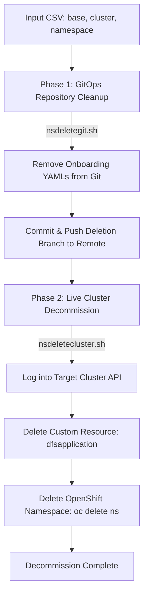

# DevOps Namespace Decommission Automation Suite

A production-grade Bash automation suite designed for multi-cluster OpenShift and GitOps environments. This directory contains two complementary scripts that handle the end-to-end decommission lifecycle of applications and namespaces.

---

## Architecture Overview: How the Two Scripts Work Together

In enterprise Kubernetes/OpenShift environments leveraging **GitOps** (e.g., Red Hat Advanced Cluster Management - ACM, ArgoCD), managing the decommission of namespaces requires a two-phase workflow:



### Why two separate scripts?
1. **Phase 1 (`nsdeletegit/nsdeletegit.sh`):** Deletes manifest definitions from Git so that GitOps sync engines (ACM / ArgoCD) do not automatically re-create the deleted resources.
2. **Phase 2 (`nsdeletecluster.sh`):** Deletes live custom resources (`dfsapplication`) to trigger operator reconciler cleanup and finalizer removal, followed by deleting the live OpenShift namespace itself.

---

## Table of Contents

- [Input CSV Specification](#input-csv-specification)
- [Script 1: `nsdeletecluster.sh` (Live Cluster Decommission)](#script-1-nsdeleteclustersh-live-cluster-decommission)
  - [Problem Statement](#problem-statement-1)
  - [Step-by-Step Execution Flow](#step-by-step-execution-flow-1)
  - [Core Shell Concepts Used](#core-shell-concepts-used-1)
- [Script 2: `nsdeletegit.sh` (GitOps Repository Cleanup)](#script-2-nsdeletegitsh-gitops-repository-cleanup)
  - [Problem Statement](#problem-statement-2)
  - [Step-by-Step Execution Flow](#step-by-step-execution-flow-2)
  - [Core Shell Concepts Used](#core-shell-concepts-used-2)
- [Interview Preparation Guide](#interview-preparation-guide)
  - [30-Second Elevator Pitch](#30-second-elevator-pitch)
  - [2-Minute In-Depth Walkthrough](#2-minute-in-depth-walkthrough)
  - [Top 7 Interview Questions & Answers](#top-7-interview-questions--answers)

---

## Input CSV Specification

Both scripts consume the same input CSV file (e.g., `input.csv`).

```csv
base,cluster,namespace
onboarding,aws-uswest2-apps-1ab-1,payment-service
onboarding,aws-useast1-apps-prod-1,auth-service
onboarding,aws-uswest2-apps-prod-2,analytics-batch
```

- **`base`**: Base directory in the Git repository (e.g., `onboarding`, `apps`, `base`).
- **`cluster`**: Target OpenShift cluster identifier matching the API mapping table.
- **`namespace`**: Name of the Kubernetes/OpenShift namespace to decommission.

---

## Script 1: `nsdeletecluster.sh` (Live Cluster Decommission)

### Problem Statement 1
When deleting namespaces in OpenShift that host operator-managed Custom Resources (such as `dfsapplication` managed by an onboarding operator), deleting the namespace directly often leaves it permanently stuck in the **`Terminating`** state due to unhandled **Finalizers**.

`nsdeletecluster.sh` automates the safe, multi-cluster live decommission process by:
1. Dynamically mapping cluster names to API server endpoints.
2. Logging into the appropriate OpenShift cluster session.
3. Switching to the operator project and deleting the Custom Resource first (allowing the operator to release finalizers).
4. Safely terminating the live namespace.

### Step-by-Step Execution Flow 1

| Step | Action | Command / Logic | Why It's Important |
| :--- | :--- | :--- | :--- |
| **Step 1** | Enable Strict Mode | `set -euo pipefail` | Aborts immediately on error, catches typos, and detects failed pipeline steps. |
| **Step 2** | Define Cluster API Map | `declare -A CLUSTER_API_MAP` | Uses an associative array for $O(1)$ lookups instead of messy chained `if/else` statements. |
| **Step 3** | Validate Input CSV | `[[ ! -f "$CSV_FILE" ]]` | Fails fast with an error message if the file is missing before running commands. |
| **Step 4** | Iterate Rows (Skip Header) | `tail -n +2 "$CSV_FILE" \| while IFS=',' read -r ...` | Skips header row and splits comma-separated fields safely. |
| **Step 5** | Sanitize Fields | `tr -d '\r' \| xargs` | Strips Windows CRLF (`\r`) line-endings and trims whitespace around names. |
| **Step 6** | Authenticate to Cluster | `oc logout && oc login "$api_url"` | Ensures clean cluster authentication and validates session with `oc whoami`. |
| **Step 7** | Delete Custom Resource | `oc project onboarding-operator`<br>`oc delete dfsapplication "$ns"` | Removes CR and triggers operator reconciler cleanup before namespace termination. |
| **Step 8** | Delete Live Namespace | `oc delete ns "$ns"` | Gracefully deletes the OpenShift namespace. |

### Core Shell Concepts Used 1
- **Associative Arrays (`declare -A`)**: Key-value mapping in native Bash.
- **Strict Error Mode (`set -euo pipefail`)**: Best practice for production shell scripts.
- **Input Sanitization (`tr`, `xargs`)**: Handling cross-platform CSV formatting issues.
- **Active Polling (`while ! oc whoami; do sleep 5; done`)**: Verifies asynchronous web/SSO authentication.

---

## Script 2: `nsdeletegit.sh` (GitOps Repository Cleanup)

### Problem Statement 2
In GitOps, the desired state of infrastructure lives in Git. If namespaces are deleted on the cluster but remain in Git, the GitOps operator will recreate them. Manually traversing nested directory trees (`base/cluster/namespace`) to find and delete YAML manifests across dozens of folders is slow and prone to human error.

`nsdeletegit.sh` automates this entire Git workflow safely with automated rollback protection.

### Step-by-Step Execution Flow 2

| Step | Action | Command / Logic | Why It's Important |
| :--- | :--- | :--- | :--- |
| **Step 1** | Validate CSV File | `[[ -f "$csv_file" ]]` | Ensures valid input file exists before touching Git. |
| **Step 2** | Validate & Enter Repo | `[[ -d "$repo_path" ]] && cd "$repo_path" \|\| exit 1` | Prevents running Git operations in an invalid directory. |
| **Step 3** | Sync Master Branch | `git checkout master && git pull origin master` | Ensures local repository is aligned with the remote source of truth. |
| **Step 4** | Create Feature Branch | `read -p ... && git checkout -b "$branch_name"` | Isolates changes in a new branch for clean pull request / merge request auditing. |
| **Step 5** | Setup Trap Rollback | `trap cleanup_branch INT TERM` | If user interrupts (`Ctrl+C`) or script fails, automatically rolls back to clean master. |
| **Step 6** | Read CSV via File Descriptor 3 | `exec 3< "$csv_file"`<br>`while ... <&3` | Prevents subshell commands from consuming CSV lines from `stdin`. |
| **Step 7** | Validate Namespace Path | `[[ -d "$dir" ]]` | Verifies existence of directory path `$base/$cluster/$ns`. |
| **Step 8** | Search & Delete Manifests | `yaml_files=$(ls *.yaml)`<br>`rm -f *.yaml` | Deletes YAML files; tracks missing or empty folders in `Skipped_ns` array. |
| **Step 9** | Stage, Commit & Push | `git add .`<br>`git commit -m "..."`<br>`git push origin "$branch_name"` | Fully automates Git lifecycle and outputs summary of skipped paths. |

### Core Shell Concepts Used 2
- **Signal Traps (`trap ... INT TERM`)**: Catches keyboard interrupts and kill signals for graceful rollback.
- **Dedicated File Descriptors (`exec 3< file`)**: Preserves standard input for interactive prompts while reading files.
- **Indexed Arrays (`Skipped_ns=()`, `Skipped_ns+=("$item")`)**: In-memory tracking for audit reporting.
- **Command Chaining & Short-Circuiting (`&&`, `||`)**: Ensures execution only continues if preceding commands succeed.

---

## Interview Preparation Guide

### 30-Second Elevator Pitch
> *"In my previous role, I automated our multi-cluster namespace decommission workflow using two complementary Bash scripts. The first script cleans up our GitOps repository by parsing a CSV, creating a dedicated feature branch, deleting application YAML manifests across dynamic directory paths, and pushing the branch for PR approval with automated `trap` rollback protection. The second script connects to our target OpenShift clusters using associative array API mappings, deletes the operator custom resources to prevent finalizer deadlocks, and terminates the live namespaces."*

---

### 2-Minute In-Depth Walkthrough
1. **The Business Problem:**
   *"Previously, decommissioning an application required engineers to manually clone the GitOps repo, navigate deep directory paths, remove YAML files, create branches, and then manually run `oc login` and `oc delete` across multiple clusters. It was slow, error-prone, and often caused namespaces to get stuck in `Terminating` because custom resources weren't deleted first."*

2. **The GitOps Cleanup Automation (`nsdeletegit.sh`):**
   *"I built `nsdeletegit.sh` to handle the version control side. It validates the input CSV and repo path, syncs master, prompts for a branch name, and registers a signal `trap`. If the script is interrupted at any point, the `trap` automatically switches back to master, deletes the temporary branch, and resets the repo to avoid leaving orphaned states. It uses a dedicated file descriptor (`FD 3`) to parse the CSV cleanly, resolves directory paths dynamically (`$base/$cluster/$ns`), deletes all YAML manifests, tracks any skipped entries in a Bash array, and finally stages, commits, and pushes the branch to remote."*

3. **The Cluster Cleanup Automation (`nsdeletecluster.sh`):**
   *"For the live cluster decommission, `nsdeletecluster.sh` uses `set -euo pipefail` for strict error handling and Bash associative arrays (`declare -A`) to map cluster names to API server endpoints. For each CSV record, it sanitizes Windows CRLF line endings, logs into the target cluster, waits for session confirmation via `oc whoami`, and then switches to the operator project to delete the `dfsapplication` custom resource first. Once the operator cleans up its finalizers, it terminates the namespace cleanly."*

---

### Top 7 Interview Questions & Answers

#### Q1: Why did you split the solution into two scripts instead of combining them into one?
> **Answer:**  
> Separation of concerns and enterprise change management. In our GitOps model, Git changes must go through a peer-reviewed Pull Request / Merge Request before being merged. Furthermore, in many enterprise environments, engineers who have permissions to modify Git may not have cluster-admin rights to delete production namespaces directly. Splitting the scripts allows the Git review workflow to happen first, followed by controlled live cluster execution.

#### Q2: Why is deleting the Custom Resource (`dfsapplication`) before deleting the namespace critical in OpenShift/Kubernetes?
> **Answer:**  
> Custom Resources often use **Kubernetes Finalizers** (`metadata.finalizers`). When a namespace deletion is requested, Kubernetes marks the namespace as `Terminating` and waits for all resources and finalizers inside it to be cleared. If the custom resource's controller or operator is stopped or unable to clear the finalizer after the namespace is marked for deletion, the namespace will hang in `Terminating` indefinitely. Deleting the CR first lets the operator complete its cleanup logic smoothly while the namespace is still active.

#### Q3: What is the purpose of `trap cleanup_branch INT TERM` in `nsdeletegit.sh`?
> **Answer:**  
> It acts as a safety rollback mechanism. If an engineer cancels the script midway via `Ctrl+C` (`SIGINT`) or if the process receives a termination signal (`SIGTERM`), the script does not leave uncommitted changes, staged files, or a dangling local branch. The `trap` automatically intercepts the signal, checks out master, deletes the incomplete branch, and runs `git reset --hard origin/master`.

#### Q4: Why did you use `exec 3< "$csv_file"` instead of a simple `while read` loop?
> **Answer:**  
> Standard `while read` loops read from standard input (`FD 0`). If any command inside the loop (like `read -p`, `ssh`, or an interactive CLI) also reads from `stdin`, it can consume remaining lines from the CSV and terminate the loop prematurely. By assigning the CSV file to dedicated File Descriptor 3 (`exec 3< ...`) and reading via `<&3`, `stdin` remains completely free for interactive user input.

#### Q5: What does `set -euo pipefail` do, and why is it important in `nsdeletecluster.sh`?
> **Answer:**  
> It is Bash's strict mode:
> - `-e`: Stops execution immediately if any command returns a non-zero exit status.
> - `-u`: Treats undefined variables as errors to prevent bugs from typos.
> - `-o pipefail`: By default, a pipeline only returns the exit status of the *last* command. With `pipefail`, if an early command in a pipeline fails, the whole pipeline fails. In cluster automation, this prevents running destructive delete commands if a preceding login or query command fails.

#### Q6: Why did you use `tr -d '\r'` during CSV processing?
> **Answer:**  
> CSV files generated or edited on Windows machines contain CRLF line endings (`\r\n`). In Linux Bash, the trailing `\r` carriage return stays attached to variable values, causing invisible directory lookup or API matching failures (e.g., trying to access `dev\r/cluster1\r/app1\r`). Using `tr -d '\r'` sanitizes the input so the script runs reliably regardless of where the CSV was created.

#### Q7: Why did you use Bash associative arrays (`declare -A`) instead of a `case` or `if/elif` block?
> **Answer:**  
> Scalability and readability. With an associative array, adding new clusters is as simple as adding a single key-value entry (`CLUSTER_API_MAP["cluster-name"]="api-url"`), and lookup is $O(1)$ constant time. A long chain of `if/elif` or `case` statements would make the script verbose, harder to maintain, and more prone to syntax errors.

---

[⬆ Back to Top](#devops-namespace-decommission-automation-suite)
